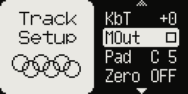
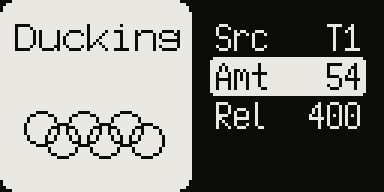

# Sidechain duck

Model:Samples only. Sidechain ducking ("pumping") without a compressor: the notes of one
track dip another track's level, which then comes back over a time you set. Kick on T1,
everything else breathing with it.

## Setting it up

Per track, in **Track Setup** (FUNC + TRACK) **> Duck**, on the track that should be
ducked:

- **Src** `OFF` / `T1`–`T6`: the track whose notes duck this one. `OFF` plays it as stock.
- **Amt** 0–100: how deep the dip goes, 0 to −60 dB (50 by default).
- **Rel** 25–1500 ms: how long the level takes to come back (200 ms by default).

Each note that starts on the source track pulls the level down in about 3 ms, then lets it
come back evenly (in decibels) over Rel. A new note on the source starts the dip again.

## P-locks

Src, Amt and Rel can be locked per step, the same way as the Strch items: in grid
recording (RECORD), open FUNC + TRACK > Duck, hold a trig on the ducked track and edit
the value. A locked item has a mark after its name. The lock applies while that step's
note plays on the ducked track.

## Good to know

- It reacts to the source's notes, not to its sound: the dip follows the trigs
  (and the pads), whatever the source track plays or how loud it is.
- The dip reaches the track's dry sound and its delay and reverb sends, the stereo
  mod's left and right, and the track's pair in USB `A16` (usb16). The delay and reverb
  returns are not ducked.
- Settings belong to the track's sound: they go with a copied sound and are saved with
  the project.
- With Src `OFF` the mix is exactly the stock one. The CPU cost is negligible.
