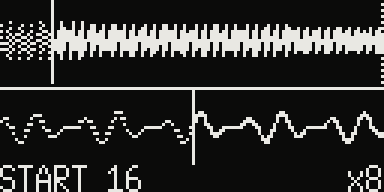
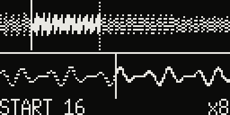
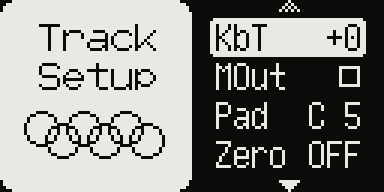
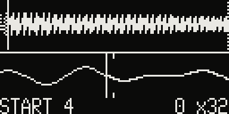

# Sample Edit

Model:Samples only. Set SMPL START and SMPL LENGTH precisely, with the sample in
sight.

## The waveform

While you turn **SMPL START** or **SMPL LENGTH**, the popup shows the sample: the
whole of it on top (the part that plays solid, the rest dotted, a line at the start
and at the end), and below it a zoomed view around the marker you are moving. The
value is shown with decimals.

## Finer steps

The knob's step follows the zoom, so one detent moves the marker about as far on the
screen at any zoom:

- the popup opens at **×8**: whole values, as stock;
- hold **PAGE** while turning: **×128**, steps of 1/16;
- turn **LEVEL/DATA** while the popup shows to zoom from ×1 to ×4096: the steps get
  finer down to 1/256 of a value, the finest the parameter holds. Hold PAGE on top of
  that for steps four times finer still.

While the popup shows, LEVEL/DATA zooms instead of changing the track level; when the
popup closes the zoom goes back to automatic. P-locks get the same steps.

## Zero crossings

**Track Setup** (FUNC + TRACK) **> Zero** `ON`, per track: the notes start, end and
loop on the zero crossing nearest to SMPL START / SMPL LENGTH, which avoids clicks.
The popup then shows the markers where the notes really start and end, with `0` next
to the zoom. The zoom stays on where the knob is (the small ticks above and below), so
you see the marker jump from one zero crossing to the next as you turn.

## Good to know

- The values are stored as the stock firmware stores them: a project plays the same
  on stock firmware, which shows only the whole part of the value.
- PAGE in grid recording still turns the pattern pages, as stock.
- Stretched notes (the Time-stretch mod) are not moved to zero crossings.
