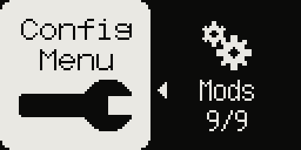
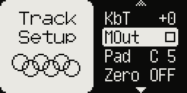

# Stereo samples

Model:Samples only. Stereo WAVs stay stereo, through the filter, the amp and the pan.

## Upload in stereo

Set **CONFIG > Device > Upload** to `ST` (default `MON`, as stock) and send stereo
WAVs with **Elektron Transfer 1.9.5 or newer**. With `MON`, Transfer mixes them to
mono as on stock firmware.

## Playback

A track playing a stereo sample is stereo through the filter, the amp and the pan; the
delay and reverb sends get its mono mix. With 16-channel USB audio (`usb16`, A16) the
track's pair carries its left and right.

**Track Setup** (FUNC + TRACK) **> Chan** `ST` / `MONO`: `MONO` plays the track's stereo
samples as their mono mix, and saves the CPU of the second channel.

## Good to know

- A stereo sample takes twice the sample memory, and each stereo track roughly 5 % more
  CPU. Several at once (five stereo tracks reach about 100 %) can make the device stop
  responding: use them wisely.
- The sample browser's preview plays the mono mix of the first ~0.7 s.
- Samples uploaded in stereo play their mono mix on the stock firmware.
