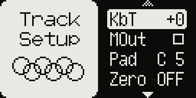
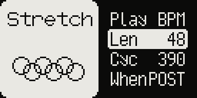
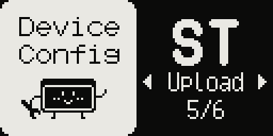

# Time-stretch

Model:Samples only. An Akai-style real-time time-stretch: the sample plays at its own
pitch for a length you choose, cut into short cycles that repeat or skip (the grainy,
metallic sound of the old samplers is part of it).

## Setting it up

Per track, in **Track Setup** (FUNC + TRACK) **> Strch**:

- **Play** `STD` / `STR` / `BPM`: stock playback / stretch by Time / stretch to the
  tempo.
- **Time** (STR): 25–400 %, the length against the original.
- **Len** (BPM): 1–128 sixteenths, the length at the project tempo.
- **Cyc**: 20–2000 frames, the cycle length: short is smoother on tones, long on beats.
- **When** (BPM): `POST` / `PRE` — the stretch applies after the SMPL START / SMPL
  LENGTH knobs (the part they pick fits Len) or before them (the whole file fits Len
  and the knobs cut a part of it).

In `BPM` the sample follows tempo changes and pitch changes while it plays, locked to
the sequencer. LOOP and REVERSE work as usual.

## P-locks

Every Strch item can be locked per step:

1. Turn on grid recording (RECORD).
2. Open FUNC + TRACK > Strch.
3. Hold one or more trigs and edit an item: the value goes to the held steps only. While
   a trig is held the page shows that step's values; a locked item has `*` after its
   name.
4. To remove an item's lock, hold the trig and turn the value down past its lowest.

- Each item is locked on its own: a step with only Len locked follows the track's Play,
  Cyc and When.
- Trigless trigs (FUNC + TRIG) work: the playing note takes the new settings from where
  it is.
- The locks are saved with the project and with Save Pattern to Project, and come back
  with Reload pattern and Undo. Up to 51 different sets of locked values per pattern.

## Back where you were

**CONFIG > Device > Last Page** (`ON` by default): FUNC + TRACK reopens Track Setup on
the row and the page you left it on.

## Good to know

- Each stretched track costs about 2 % CPU.
- A project with stretch locks loads and plays on stock firmware (without the stretch)
  and loads back with all its locks on the mod.
