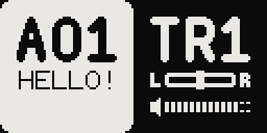

# USB 16 channels

16-channel USB audio. **CONFIG > Device > USB MODE** cycles `A+M` → `A16` → `MID`:

- `A+M`: stock, the stereo mix plus MIDI.
- `A16`: 16 channels plus MIDI.
- `MID`: MIDI only.

In `A16` the channels are, at 48 kHz / 24 bit:

- **1–12** `T1 L` … `T6 R`: the six tracks as stereo pairs, after VOL and PAN;
- **13–14** `Delay L`, `Delay R`: the delay return;
- **15–16** `Reverb L`, `Reverb R`: the reverb return.

Each channel is exactly what the mixer adds to the main bus, with the same gain curve
and master gain, so the 16 channels sum to the stereo mix. A track muted on the device
is silent on its channels; its delay and reverb tail stays on 13–16.

## Good to know

- After flashing the device starts in `A+M`, which behaves as stock. Pick `A16` once; it
  is kept across power cycles. Switching reconnects the device, so the DAW may need its
  input device selected again.
- Record and play on **one clock**: the Model as both the input and the output device,
  or an aggregate device with drift correction (macOS Audio MIDI Setup).
- On the Model:Samples A16 costs about 5 % more CPU than A+M: with stereo samples and
  stretched tracks the device can run out of it.
- Tested on Model:Cycles and Model:Samples with macOS. Windows is untested.

Based on [ms-multi-output](https://github.com/scottmetoyer/ms-multi-output) by Scott
Metoyer and the work on it in [Modded-Cycles](https://github.com/18nelli18/Modded-Cycles)
by 18nelli.
